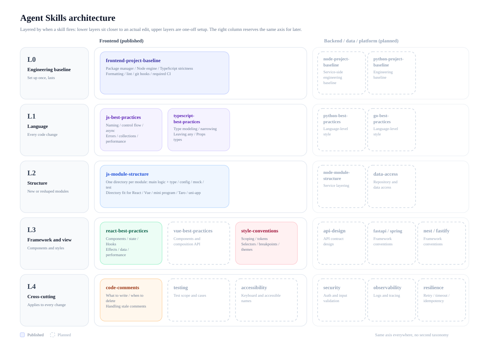
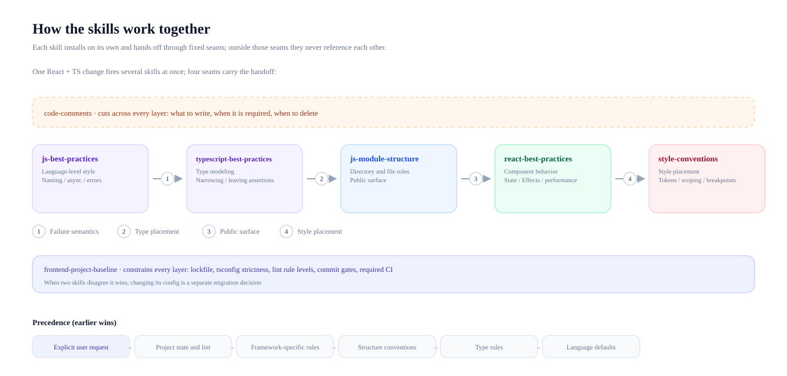
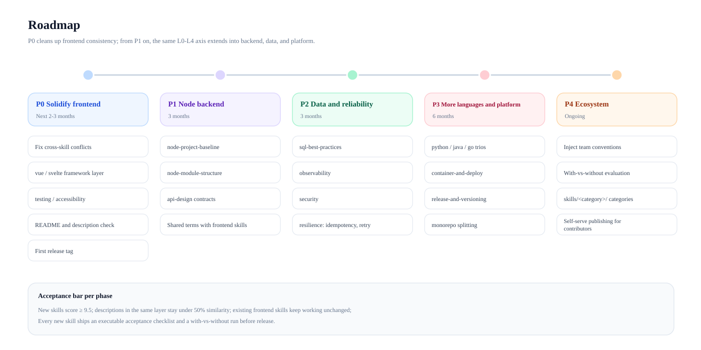

[中文](ROADMAP.md) | [English](ROADMAP.en.md)

# Architecture and roadmap

This repository collects Agent Skills. Every skill is a self-contained directory and installs on its own. This document answers three questions: how the current skills are layered, how they hand off when they are loaded together, and where the collection grows next.

The figures are generated by `node scripts/build-roadmap-diagrams.mjs`, in both Chinese and English.

## 1. Layered architecture

The layers are defined by **when a skill gets triggered**, not by tech stack. Skills in the same layer can replace each other; different layers answer different questions.

| Layer | When it fires | Published | Planned |
| --- | --- | --- | --- |
| L0 Engineering baseline | Set up once, applies long term | frontend-project-baseline | node / python baselines |
| L1 Language | Every code change | js-best-practices, typescript-best-practices | python / go |
| L2 Structure | New or reshaped modules | js-module-structure | service layering, data access |
| L3 Framework and view | Components and styles | react-best-practices, style-conventions | vue / svelte, backend frameworks, API contracts |
| L4 Cross-cutting | Applies to every change | code-comments | testing, accessibility, security, observability, resilience |

Three rules for placing a skill:

- One layer answers one kind of question. Rules from another layer stay out of it.
- Upper layers constrain lower ones: the lockfile, strictness, and command names fixed in L0 decide how the layers below are checked.
- A new skill finds its layer first. If no layer fits, the layering needs adjusting, not a second taxonomy.

## 2. How the skills work together

One React + TS change fires five or six skills at once. They never reference each other; four fixed seams carry the handoff:

| Seam | From | To | What it hands over |
| --- | --- | --- | --- |
| Failure semantics | js-best-practices | typescript-best-practices | What counts as a business failure, return value or exception |
| Type placement | typescript-best-practices | js-module-structure | Which file a type belongs in, where value sets live |
| Public surface | js-module-structure | react-best-practices | Module entry, named-export exceptions |
| Style placement | react-best-practices | style-conventions | Styles in the component or global, where values come from |

When two skills disagree, resolve in this order, earlier wins:

**Explicit user request → project state and lint → framework-specific rules → structure conventions → type rules → language defaults**

Two hard constraints:

- **Skills never reference each other.** Each skill must install on its own; the cost is that principles such as "follow the project as it stands" appear in every skill.
- **Shared vocabulary must stay in sync.** Directory naming, the `I` / `E` prefixes, `xxx.type.ts`, and component form all appear in several skills, so changing one means changing the rest. The README description column is already enforced by the validator; terminology is not.

## 3. Coverage and gaps

| Layer | Frontend | Node / TS services | Python / Java / Go | Data and platform |
| --- | --- | --- | --- | --- |
| L0 Baseline | Yes | Missing | Missing | Missing |
| L1 Language | Yes | Reuses JS / TS | Missing | |
| L2 Structure | Yes | Missing | Missing | |
| L3 Framework | Partial, React only | Missing | Missing | |
| L4 Cross-cutting | Partial, comments only | Missing | Missing | |

Frontend gaps by impact: Vue / Svelte framework layer > testing > accessibility > state management > i18n > performance budgets.

## 4. Roadmap

| Phase | Goal | Deliverables | Done when |
| --- | --- | --- | --- |
| P0 Solidify frontend | Clean up consistency | Fix cross-skill conflicts, Vue / Svelte, testing and accessibility, README check, first release tag | Every skill scores ≥ 9.5 and a full stack still loads under 35 KB |
| P1 Node backend | Extend along the same axis | node-project-baseline, node-module-structure, api-design | Existing frontend skills keep working unchanged |
| P2 Data and reliability | Fill in L4 | sql-best-practices, observability, security, resilience | Each cross-cutting skill works for frontend and backend |
| P3 More languages and platform | Repeat for other stacks | python / java / go trios, container-and-deploy, release-and-versioning | Descriptions within one layer stay under 50% similarity |
| P4 Ecosystem | Let others self-serve | Team convention injection, with-vs-without evaluation, `skills/<category>/` | External contributors can publish following CONTRIBUTING |

Every phase uses the same acceptance bar:

- New skills target ≥ 9.5 (the CI gate is 8.5, see AGENTS.md).
- Descriptions within one layer stay under 50% similarity so trigger ranges do not collide.
- Every skill ships an executable acceptance checklist and a with-vs-without run before release.

## 5. Adding a skill

Names follow the layer, so the suffix says what the skill owns:

| Suffix | Owns | Example |
| --- | --- | --- |
| `-project-baseline` | Engineering baseline | node-project-baseline |
| `-best-practices` | Language or framework conventions | vue-best-practices |
| `-module-structure` | Directories, file roles, public surface | node-module-structure |
| `-conventions` | Conventions for one kind of artifact | style-conventions, api-conventions |

The flow and gates live in [CONTRIBUTING.en.md](CONTRIBUTING.en.md): scaffold with `new-skill.mjs`, pass `validate-skills.mjs` with zero errors, clear the score gate, register one row in both README tables.

## 6. Promoting the collection

- **Pitch to three audiences.** Individual developers care that one skill installs on its own; team leads care about the engineering baseline and review checklists; platform teams care about the template and running their own repository.
- **Lead with one figure and one command.** The figure is the layered architecture above; the command is `npx skills add zn-craft/agent-skills --skill <name>`.
- **Publish a comparison instead of adjectives.** Every skill ships an acceptance checklist; run a few typical tasks with and without the skill and put the results in the README.
- **Give consumers a version anchor.** Installs come from the main branch; enterprise adopters worry about upstream drift, so tag early and state which version the README pins.
