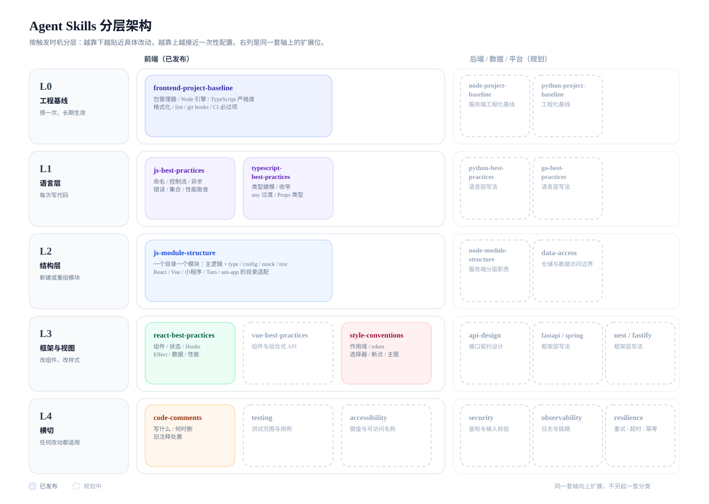
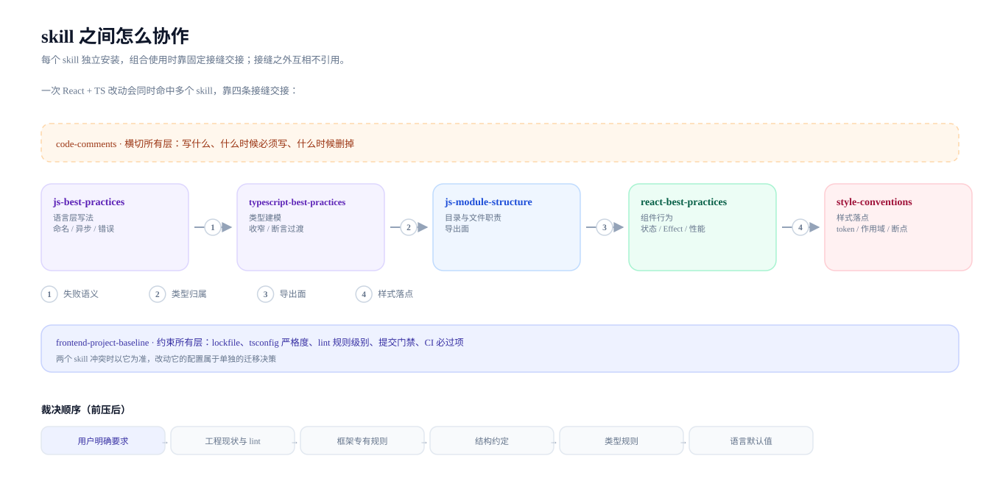
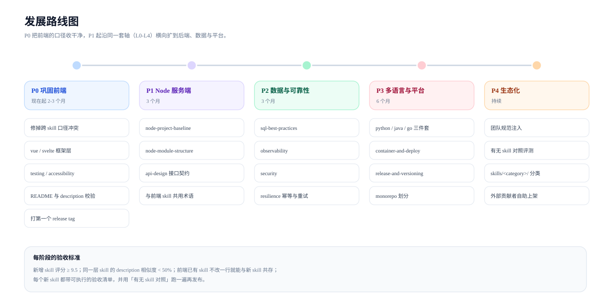

[中文](ROADMAP.md) | [English](ROADMAP.en.md)

# 架构与路线图

这个仓库沉淀 Agent Skill，每个 skill 是独立目录，按单条安装。这份文档回答三件事：现在这些 skill 怎么分层、组合使用时怎么交接、后面往哪扩。

配图由 `node scripts/build-roadmap-diagrams.mjs` 生成，中英各一套。

## 一、分层架构

分层依据是**什么时候被触发**，与技术栈无关。同一层的 skill 可以互相替换，不同层各答一类问题。

| 层 | 什么时候被触发 | 已发布 | 扩展位 |
| --- | --- | --- | --- |
| L0 工程基线 | 搭一次，长期生效 | frontend-project-baseline | node / python 工程化基线 |
| L1 语言层 | 每次写代码 | js-best-practices、typescript-best-practices | python / go 语言层 |
| L2 结构层 | 新建或重组模块 | js-module-structure | 服务端分层、数据访问边界 |
| L3 框架与视图 | 改组件、改样式 | react-best-practices、style-conventions | vue / svelte、后端框架、接口契约 |
| L4 横切 | 任何改动都适用 | code-comments | 测试、无障碍、安全、可观测、重试幂等 |

三条判断规则：

- 一层只回答一类问题。跨层的规则不写进本层，翻不到就说明分层表该更新了。
- 上层约束下层：L0 定下来的锁文件、严格度和命令，决定下面几层怎么被检查。
- 新 skill 先找层。找不到层，说明分层需要调整，而不是另起一套分类。

## 二、skill 之间怎么协作

一次 React + TS 改动会同时命中 5 到 6 个 skill。它们不互相引用，靠四条固定接缝交接：

| 接缝 | 谁交给谁 | 交接的是什么 |
| --- | --- | --- |
| 失败语义 | js-best-practices → typescript-best-practices | 什么算业务失败、用返回值还是异常 |
| 类型归属 | typescript-best-practices → js-module-structure | 类型写在哪个文件、取值定义放哪 |
| 导出面 | js-module-structure → react-best-practices | 模块入口、具名导出的例外 |
| 样式落点 | react-best-practices → style-conventions | 样式写组件里还是全局、变量从哪来 |

两个 skill 给出冲突结论时，按这个顺序裁决，前者压后者：

**用户明确要求 → 工程现状与 lint → 框架专有规则 → 结构约定 → 类型规则 → 语言默认值**

两条硬约束：

- **skill 之间不互相引用。** 每条 skill 都要能单独安装，代价是"先沿用工程现状"这类原则得在每个 skill 里各写一遍。
- **跨 skill 的口径必须一致。** 目录命名、`I` / `E` 前缀、`xxx.type.ts`、组件写法在多个 skill 里都出现，改一处要同步其余几处。README 的说明列已由校验脚本盯住，术语还没有。

## 三、覆盖现状与缺口

| 层 | 前端 | Node / TS 服务端 | Python / Java / Go | 数据与平台 |
| --- | --- | --- | --- | --- |
| L0 工程基线 | 有 | 缺 | 缺 | 缺 |
| L1 语言 | 有 | 复用 JS / TS | 缺 | |
| L2 结构 | 有 | 缺 | 缺 | |
| L3 框架 | 部分，只有 React | 缺 | 缺 | |
| L4 横切 | 部分，只有注释 | 缺 | 缺 | 缺 |

前端这一侧的缺口，按影响排序：Vue / Svelte 框架层 > 测试 > 无障碍 > 状态管理 > 国际化 > 性能预算。

## 四、发展路线图

| 阶段 | 目标 | 主要产出 | 完成标志 |
| --- | --- | --- | --- |
| P0 巩固前端 | 把口径收干净 | 修跨 skill 冲突、Vue / Svelte 框架层、测试与无障碍、README 校验、打第一个 release tag | 全部 skill 评分 ≥ 9.5，组合加载仍 ≤ 35 KB |
| P1 Node 服务端 | 沿同一套轴向服务端扩 | node-project-baseline、node-module-structure、api-design | 前端已有 skill 不改一行就能与新 skill 共存 |
| P2 数据与可靠性 | 补齐 L4 横切 | sql-best-practices、observability、security、resilience | 每个横切 skill 都能同时被前端和后端引用 |
| P3 多语言与平台 | 复制到其他语言 | python / java / go 三件套、container-and-deploy、release-and-versioning | 同层 skill 的 description 相似度低于 50% |
| P4 生态化 | 让外部能自助 | 团队规范注入、有无 skill 对照评测、`skills/<category>/` 分类 | 外部贡献者能按 CONTRIBUTING 独立上架 |

每个阶段的验收标准都一样：

- 新 skill 评分目标 ≥ 9.5（CI 门禁是 8.5，见 AGENTS.md）。
- 同层 skill 的 description 相似度低于 50%，避免触发范围打架。
- 每个 skill 带可执行的验收清单，发布前用"有无 skill 对照"跑一遍。

## 五、新增 skill 时

命名跟着层走，看名字就知道它管什么：

| 后缀 | 管什么 | 例子 |
| --- | --- | --- |
| `-project-baseline` | 工程化基线 | node-project-baseline |
| `-best-practices` | 语言或框架层写法 | vue-best-practices |
| `-module-structure` | 目录、文件职责与导出面 | node-module-structure |
| `-conventions` | 某类产物的写法约定 | style-conventions、api-conventions |

流程和门禁见 [CONTRIBUTING.md](CONTRIBUTING.md)：`new-skill.mjs` 起骨架，`validate-skills.mjs` 零错误，`score-skills.mjs` 过线，README 两份表格各登记一行。

## 六、怎么推广

- **受众分三层讲。** 个人开发者看"装一条就能用"，团队 TL 看工程化基线和评审清单，平台团队看 skill 模板与自建仓库。
- **主推一张图和一条命令。** 图就是上面第一张分层图，命令是 `npx skills add zn-craft/agent-skills --skill <name>`。
- **用对照评测代替自夸。** 每个 skill 都自带验收清单，抽几个典型任务做"有无 skill"对照，把结果放进 README，比形容词有说服力。
- **给版本锚点。** 使用者装的是主分支，企业接入会关心上游漂移，尽早打 tag 并在 README 写明锁哪个版本。
